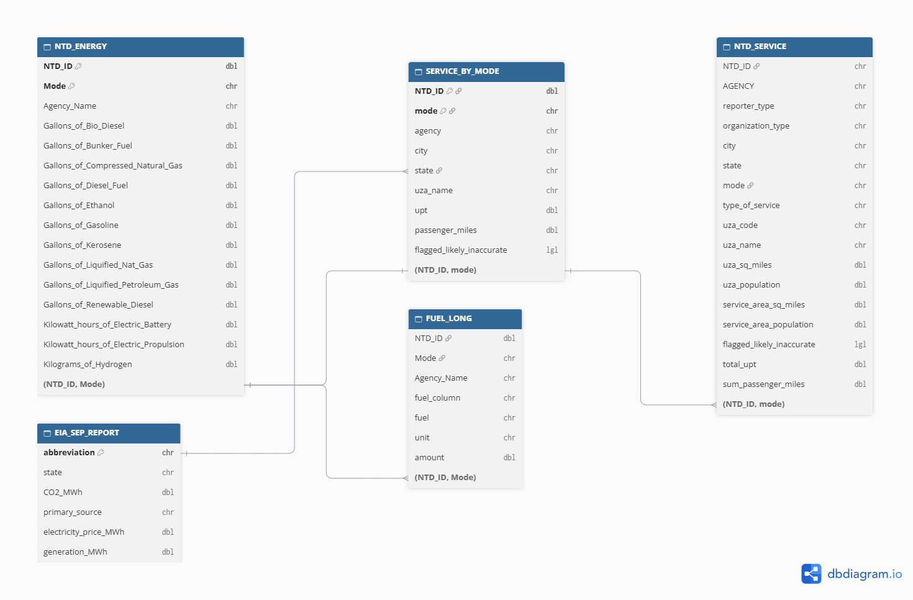

## Setup

```{r}
#| label: setup
library(tidyverse)
library(httr2)
library(rvest)
library(fs)
library(readxl)
library(gt)
library(scales)
library(ggrepel)

LB_PER_GAL_GASOLINE <- 18.73
LB_PER_GAL_DIESEL <- 22.45
LB_PER_GAL_KEROSENE <- 21.78
LB_PER_GAL_RENEWABLE_DIESEL <- LB_PER_GAL_DIESEL
LB_PER_GAL_LPG <- 12.68
LB_PER_GAL_BUNKER <- 24.78 
LB_PER_MCF_NAT_GAS <- 120.85


LB_PER_KG <- 2.20462
LB_PER_GAL_BIODIESEL <- 9.45 * LB_PER_KG
LB_PER_GAL_ETHANOL <- 5.75 * LB_PER_KG
LB_PER_GAL_LNG <- 4.50 * LB_PER_KG

SCF_PER_GGE_CNG <- 123.57
LB_PER_GGE_CNG <- SCF_PER_GGE_CNG / 1000 * LB_PER_MCF_NAT_GAS

LB_PER_KG_HYDROGEN <- 0


CAFE_MPG <- 34.9
CAFE_MPG_PRIOR <- 49
LB_PER_METRIC_TON <- 2204.62
MIN_UPT <- 100000
TIER_BREAKS <- c(MIN_UPT, 1e6, 20e6, Inf)
TIER_LABELS <- c("Small", "Medium", "Large")

TIER_COLOR <- "#1B7F5C"
MUTED_COLOR <- "grey75"
ALERT_COLOR <- "#B5392E"

theme_gta <- function() {
  theme_minimal(base_size = 15) +
    theme(
      plot.title = element_text(face = "bold"),
      plot.title.position = "plot",
      plot.caption = element_text(color = "grey40", size = 10, hjust = 0),
      plot.caption.position = "plot",
      panel.grid.minor = element_blank()
    )
}

fmt_int <- label_comma(accuracy = 1)
```

## Data Acquisition

### State Electricity Profiles

```{r}
#| label: load-eia
get_eia_sep <- function(state, abbr){
    library(tidyverse)
    library(stringr)
    library(httr2)
    library(rvest)
    library(fs)
  
    state_formatted <- str_to_lower(state) |> str_replace_all("\\s", "")
    
    dir_name <- fs::path("data", "mp02")
    file_name <- fs::path(dir_name, state_formatted)
    
    fs::dir_create(dir_name, recurse=TRUE)
    
    if(!fs::file_exists(file_name)){
        BASE_URL <- "https://www.eia.gov"
        RESPONSE <- request(BASE_URL) |> 
          req_url_path("electricity", 
                       "state", 
                       state_formatted) |>
          req_headers(
            `User-Agent` = "Mozilla/5.0 (Macintosh; Intel Mac OS X 10.15; rv:149.0) Gecko/20100101 Firefox/149.0"
            ) |>   
          req_retry(
                max_tries = 4, 
          ) |>
          req_perform(file_name)
    
        resp_check_status(RESPONSE)
    }
    
    TABLE <- read_html(file_name) |> 
        html_element("table") |> 
        html_table() |>
        mutate(Item = str_to_lower(Item))
    
    if("U.S. rank" %in% colnames(TABLE)){
        TABLE <- TABLE |> rename(Rank = `U.S. rank`)
    }
    
    CO2_MWh <- TABLE |> 
        filter(Item == "carbon dioxide (lbs/mwh)") |>
        pull(Value) |> 
        str_replace_all(",", "") |>
        as.numeric()
    
    PRIMARY <- TABLE |> 
        filter(Item == "primary energy source") |> 
        pull(Rank)
    
    RATE <- TABLE |>
        filter(Item == "average retail price (cents/kwh)") |>
        pull(Value) |>
        as.numeric()
    
    GENERATION_MWh <- TABLE |>
        filter(Item == "net generation (megawatthours)") |>
        pull(Value) |>
        str_replace_all(",", "") |>
        as.numeric()
    
    data.frame(CO2_MWh               = CO2_MWh, 
               primary_source        = PRIMARY,
               electricity_price_MWh = RATE * 10, # / 100 cents to dollars &
               # * 1000 kWh to MWH 
               generation_MWh        = GENERATION_MWh, 
               state                 = state, 
               abbreviation          = abbr
    )
}

EIA_SEP_REPORT <- map2(state.name, state.abb, get_eia_sep) |> list_rbind()
```

### Energy Consumption

```{r}
#| label: load-energy
load_ntd_energy <- function(){
  library(readxl)
  library(httr2)
  library(tidyverse)
  library(fs)
  
 
  DATA_DIR <- fs::path("data", "mp02")
  fs::dir_create(DATA_DIR, recurse=TRUE)

  NTD_ENERGY_FILE <- fs::path(DATA_DIR, "2025_ntd_energy.xlsx")

  if(!fs::file_exists(NTD_ENERGY_FILE)){
    library(httr2)
  
    request("https://www.transit.dot.gov/") |>
      req_url_path("sites",
                   "fta.dot.gov",
                   "files",
                   "2026-09",
                   "2025 Energy Consumption_260806.xlsx") |> 
      req_headers(
        `User-Agent` = "Mozilla/5.0 (Macintosh; Intel Mac OS X 10.15; rv:149.0) Gecko/20100101 Firefox/149.0") |> 
      req_perform(NTD_ENERGY_FILE)
  }
  
  if(file.info(NTD_ENERGY_FILE)$size < 1e4){
        cat("I was unable to download the NTD Energy File. Please try again.\n")
        stop("Download failed. Please delete the corrupted file by running `unlink('data/mp02/2025_ntd_energy.xlsx')` and try again.")
    }

  to_numeric_fill_0 <- function(x){
    x <- if_else(x == "-", NA, x)
    replace_na(as.numeric(x), 0)
  }

  read_excel(NTD_ENERGY_FILE) |> 
    select(-c(`Reporter Type`, 
              `Reporting Module`, 
              `Gallons of Other Fuel`, 
              `Other Fuel Description`)) |>
    mutate(across(-c(`Agency Name`, 
                     `Mode`,
                     `TOS`), 
                  to_numeric_fill_0)) |>
    group_by(`NTD ID`, `Mode`, `Agency Name`) |>
    summarize(across(where(is.numeric), sum), 
              .groups = "keep") |>
    mutate(ENERGY = sum(c_across(c(where(is.numeric))))) |>
    filter(ENERGY > 0) |>
    select(-ENERGY) |>
    ungroup()
}

NTD_ENERGY <- load_ntd_energy()
```

### Transit Service Provided

```{r}
#| label: load-service
load_ntd_service <- function(){
  library(httr2)
  library(tidyverse)
  library(fs)
  

  DATA_DIR <- fs::path("data", "mp02")
  fs::dir_create(DATA_DIR, recurse=TRUE)

  NTD_SERVICE_FILE <- fs::path(DATA_DIR, "2025_ntd_service.csv")

  if(!fs::file_exists(NTD_SERVICE_FILE)){
    library(httr2)
  
    request("https://data.transportation.gov/resource/4fir-qbim.csv") |>
      req_url_query(`$query`=paste(
        "SELECT  `_5_digit_ntd_id` AS `NTD_ID`", 
        "`max_agency` AS `AGENCY`",
        "`max_reporter_type` AS `reporter_type`",
        "`max_organization_type` AS `organization_type`",
        "`max_city` AS `city`",
        "`max_state` AS `state`",
        "`mode`",
        "`type_of_service`",
        "`max_primary_uza_code` as `uza_code`",
        "`max_primary_uza_name` as `uza_name`",
        "`max_primary_uza_area_sq_miles` as `uza_sq_miles`",
        "`max_primary_uza_population` as `uza_population`",
        "`max_service_area_sq_miles` as `service_area_sq_miles`",
        "`max_service_area_population` as `service_area_population`",
        "`questionable_record` as `flagged_likely_inaccurate`",
        "`sum_unlinked_passenger_trips_upt` as `total_upt`",
        "`sum_passenger_miles` WHERE caseless_one_of(`report_year`, '2025') limit 50000", 
        sep=",")) |>
      req_headers(
        `User-Agent` = "Mozilla/5.0 (Macintosh; Intel Mac OS X 10.15; rv:149.0) Gecko/20100101 Firefox/149.0") |> 
      req_perform(NTD_SERVICE_FILE)
  }
  
  if(file.info(NTD_SERVICE_FILE)$size < 1e4){
        cat("I was unable to download the NTD Service File. Please try again.\n")
        stop("Download failed. Please delete the corrupted file by running `unlink('data/mp02/2025_ntd_service.xlsx')` and try again.")
    }

  read_csv(NTD_SERVICE_FILE) |>
    mutate(flagged_likely_inaccurate = !is.na(flagged_likely_inaccurate))
}

NTD_SERVICE <- load_ntd_service()
```

## Data Cleaning and Preparation

```{r}
#| label: type-checks
#| eval: false
glimpse(EIA_SEP_REPORT)
glimpse(NTD_ENERGY)
glimpse(NTD_SERVICE)
NTD_ENERGY |> distinct(Mode)
NTD_SERVICE |> distinct(mode)
```

```{r}
#| label: recode-mode

recode_mode <- function(code) {
  recode_values(
    code,
    "AG" ~ "Automated Guideway",
    "AR" ~ "Alaska Railroad",
    "CB" ~ "Commuter Bus",
    "CC" ~ "Cable Car",
    "CR" ~ "Commuter Rail",
    "DR" ~ "Demand Response",
    "DT" ~ "Demand Response Taxi",
    "FB" ~ "Ferryboat",
    "HR" ~ "Heavy Rail",
    "IP" ~ "Inclined Plane",
    "JT" ~ "Jitney",
    "LR" ~ "Light Rail",
    "MB" ~ "Bus",
    "MG" ~ "Monorail/Automated Guideway",
    "PB" ~ "Publico",
    "RB" ~ "Bus Rapid Transit",
    "SR" ~ "Streetcar Rail",
    "TB" ~ "Trolleybus",
    "TR" ~ "Aerial Tramway",
    "VP" ~ "Vanpool",
    "YR" ~ "Hybrid Rail",
    default = "Unknown"
  )
}


NTD_ENERGY <- NTD_ENERGY |>
  select(-`Bio-Diesel Description`) |>
  filter(`NTD ID` > 0) |>
  mutate(Mode = recode_mode(Mode))

OTHER_FUEL <- read_excel(path("data", "mp02", "2025_ntd_energy.xlsx")) |>
  transmute(
    `NTD ID` = as.numeric(`NTD ID`),
    Mode = recode_mode(Mode),
    `Agency Name`,
    other_gallons = as.numeric(`Gallons of Other Fuel`)
  ) |>
  filter(`NTD ID` > 0, other_gallons > 0) |>
  group_by(`NTD ID`, Mode, `Agency Name`) |>
  summarize(`Gallons of Renewable Diesel` = sum(other_gallons), .groups = "drop")

NTD_ENERGY <- NTD_ENERGY |>
  full_join(OTHER_FUEL, by = join_by(`NTD ID`, Mode, `Agency Name`)) |>
  mutate(across(where(is.numeric), \(x) replace_na(x, 0)))
SERVICE_BY_MODE <- NTD_SERVICE |>
  mutate(NTD_ID = as.numeric(NTD_ID), mode = recode_mode(mode)) |>
  filter(!is.na(NTD_ID)) |>
  group_by(NTD_ID, mode) |>
  summarize(
    agency = first(AGENCY),
    city = first(city),
    state = first(state),
    uza_name = first(uza_name),
    upt = sum(total_upt, na.rm = TRUE),
    passenger_miles = sum(sum_passenger_miles, na.rm = TRUE),
    flagged_likely_inaccurate = any(flagged_likely_inaccurate),
    .groups = "drop"
  )
```


## Exploring the Data

#### TASK 2: Mode Analysis

````{r}
#| label: tbl-mode-counts
NTD_ENERGY |>
  count(Mode, sort = TRUE, name = "Services") |>
  gt()
````

Bus and Demand Response where you book in advance seems to be the highest. Most US transit agencies run vehicles.

#### Task 3a

#### State Electricity Profiles

##### Q1.

   `r EIA_SEP_REPORT |> slice_max(electricity_price_MWh, n = 5) |> pull(state) |> str_flatten_comma()` have the highest retail prices.


```{r}
#| label: fig-electricity-price
#| fig-height: 5
#| fig-width: 10
EIA_SEP_REPORT |>
  slice_max(electricity_price_MWh, n = 5) |>
  ggplot(aes(
    x = electricity_price_MWh,
    y = fct_reorder(state, electricity_price_MWh)
  )) +
  geom_col(fill = TIER_COLOR) +
  geom_text(
    aes(label = label_dollar(accuracy = 1)(electricity_price_MWh)),
    hjust = 1.2, color = "white", fontface = "bold"
  ) +
  scale_x_continuous(labels = label_dollar(), expand = c(0, 0)) +
  labs(
    x = "Average retail price per MWh",
    y = NULL,
    caption = "Source: EIA State Electricity Profiles."
  ) +
  theme_gta()
```
##### Q2.

`r EIA_SEP_REPORT |> slice_max(CO2_MWh, n = 5) |> pull(state) |> str_flatten_comma()` are high CO2 states

```{r}
EIA_SEP_REPORT |>
  slice_max(CO2_MWh, n = 5) |>
  select(state, CO2_MWh, primary_source, generation_MWh) |>
  gt() |>
  tab_header(title =" State CO2") |>
  cols_label(
    state = "State",
    CO2_MWh = "CO2 (lb/MWh)",
    primary_source = "Primary source",
    generation_MWh = "Net generation (MWh)"
  ) |>
  fmt_integer(c(CO2_MWh, generation_MWh)) |>
  tab_source_note("Source: EIA State Electricity Profiles.")
```


```{r}
#| label: us-average-co2
us_avg_co2 <- weighted.mean(
  EIA_SEP_REPORT$CO2_MWh,
  EIA_SEP_REPORT$generation_MWh
)

state_co2 <- function(abbr) {
  EIA_SEP_REPORT |>
    filter(abbreviation == abbr) |>
    pull(CO2_MWh)
}
tx_to_ny_ratio <- state_co2("TX") / state_co2("NY")
```
##### Q3.

On average this much pounds `r fmt_int(us_avg_co2)` lb CO2 emitted per MWh of electricity produced in USA.

##### Q4. 

Rarest primary energy sources in the USA

```{r}
EIA_SEP_REPORT |>
  group_by(primary_source) |>
  summarize(
    n_states = n(),
    price = weighted.mean(electricity_price_MWh, generation_MWh),
    states = str_flatten_comma(sort(abbreviation))
  ) |>
  slice_min(n_states, n = 3, with_ties = FALSE) |>
  gt() |>
  tab_header(title = "Rarest Sources") |>
  cols_label(
    primary_source = "Primary source",
    n_states = "States",
    price = "Generation-weighted price per MWh",
    states = "Where used"
  ) |>
  fmt_currency(price, decimals = 2) |>
  tab_source_note("Source: EIA State Electricity Profiles.")
```

##### Q5.

For Texas its `r fmt_int(state_co2("TX"))` lbs of CO2 released per MWh and New York its roughly `r fmt_int(state_co2("NY"))`, so NY is around `r round(tx_to_ny_ratio, 2)` times cleaner.

### NTD Energy Usage

#### Task 3b


```{r}
FUEL_LONG <- NTD_ENERGY |>
  pivot_longer(
    -c(`NTD ID`, Mode, `Agency Name`),
    names_to = "fuel_column",
    values_to = "amount"
  ) |>
  mutate(
    unit = str_extract(fuel_column, "^\\w+( hours)?"),
    fuel = str_remove(fuel_column, "^(Gallons|Kilowatt hours|Kilograms) of ")
  )

FUEL_TOTALS <- FUEL_LONG |>
  group_by(fuel, unit) |>
  summarize(
    total = sum(amount),
    n_services = sum(amount > 0),
    .groups = "drop"
  )

least_used_fuels <- FUEL_TOTALS |>
  filter(n_services > 0) |>
  slice_min(n_services, n = 1)
unused_fuels <- FUEL_TOTALS |>
  filter(n_services == 0) |>
  pull(fuel)
```


##### Q1.

Table of five transit agencies using most gallon of fuel breakdown by type.


```{r}
#| label: top-fuel-agencies
TOP_FUEL_AGENCIES <- FUEL_LONG |>
  filter(unit == "Gallons") |>
  group_by(`NTD ID`, `Agency Name`, fuel) |>
  summarize(amount = sum(amount), .groups = "drop_last") |>
  mutate(total_gallons = sum(amount)) |>
  ungroup() |>
  filter(dense_rank(desc(total_gallons)) <= 5)

TOP_FUEL_AGENCIES |>
  filter(amount > 0) |>
  mutate(share = amount / total_gallons) |>
  select(`Agency Name`, total_gallons, fuel, share) |>
  pivot_wider(names_from = fuel, values_from = share, values_fill = 0) |>
  arrange(desc(total_gallons)) |>
  gt() |>
  cols_label(
    `Agency Name` = "Agency",
    total_gallons = "Total gallons"
  ) |>
  fmt_integer(total_gallons) |>
  fmt_percent(-c(`Agency Name`, total_gallons), decimals = 1) |>
  tab_source_note("Source: NTD 2025 Energy Consumption.")
```

##### Q2.

Visual of amounts of each type of fuel across US public transit

```{r}
#| label: fuel-totals
#| fig-height: 7
#| fig-width: 10
# Gallons, kWh, and kilograms are not comparable, so each unit gets a panel.
FUEL_TOTALS |>
  filter(total > 0) |>
  ggplot(aes(x = total, y = fct_reorder(fuel, total))) +
  geom_col(fill = TIER_COLOR) +
  facet_wrap(~unit, scales = "free", ncol = 1) +
  scale_x_continuous(labels = label_number(scale_cut = cut_short_scale())) +
  labs(
    x = "Total used in 2025",
    y = NULL,
    caption = "Source: NTD 2025 Energy Consumption."
  ) +
  theme_gta()
```

##### Q3.

The least commonly used fuel source for US public transit is `r str_flatten_comma(least_used_fuels$fuel)`

### NTD Service

#### Task 3c.

##### Q1.

Most UPT annually for Transit Services

```{r}
#| label: top-upt
#| fig-height: 5
#| fig-width: 10
SERVICE_BY_MODE |>
  slice_max(upt, n = 5) |>
  mutate(service = str_c(agency, "\n", mode)) |>
  ggplot(aes(x = upt, y = fct_reorder(service, upt))) +
  geom_col(fill = TIER_COLOR) +
  scale_x_continuous(
    labels = label_number(scale_cut = cut_short_scale()),
    expand = expansion(mult = c(0, 0.05))
  ) +
  labs(
    x = "Unlinked passenger trips, 2025",
    y = NULL,
    caption = "Source: NTD 2025 Service data."
  ) +
  theme_gta()
```

```{r}
#| label: nyc-trip-length
# CHECK: run `NTD_SERVICE |> distinct(AGENCY, city) |>
# filter(str_detect(AGENCY, "MTA"))` to confirm these names on the real data.
NYC_CITIES <- c("New York City", "New York", "Brooklyn", "Staten Island")

mta_nyc <- SERVICE_BY_MODE |>
  filter(str_detect(agency, "MTA New York City Transit")) |>
  summarize(avg_trip = sum(passenger_miles) / sum(upt))

longest_nyc_trip <- SERVICE_BY_MODE |>
  filter(city %in% NYC_CITIES, upt > 0) |>
  mutate(avg_trip = passenger_miles / upt) |>
  slice_max(avg_trip, n = 1, with_ties = FALSE)

states_missing <- setdiff(state.abb, SERVICE_BY_MODE$state)
missing_names <- state.name[state.abb %in% states_missing]
```

##### Q2.

Average Trip length of a trip on MTA MYC is `r round(mta_nyc$avg_trip, 2)` miles.

##### Q3.

The `r longest_nyc_trip$agency`, has the longest average trip length which is `r round(longest_nyc_trip$avg_trip, 1)` miles per trip.

##### Q4.

States with the fewest miled traveled by Public Transit

```{r}
#| label: fewest-miles
#| fig-height: 5
#| fig-width: 10
SERVICE_BY_MODE |>
  filter(state %in% state.abb) |>
  group_by(state) |>
  summarize(passenger_miles = sum(passenger_miles)) |>
  slice_min(passenger_miles, n = 5) |>
  ggplot(aes(x = passenger_miles, y = fct_reorder(state, -passenger_miles))) +
  geom_col(fill = TIER_COLOR) +
  scale_x_continuous(
    labels = label_number(scale_cut = cut_short_scale()),
    expand = expansion(mult = c(0, 0.05))
  ) +
  labs(
    x = "Passenger miles, 2025",
    y = NULL,
    caption = "Source: NTD 2025 Service data."
  ) +
  theme_gta()
```
##### Q5.

`r if (length(missing_names) > 0) str_flatten_comma(missing_names) else "No States"`are missing in the data

## Joining the Tables

### Task 4

```{mermaid}
erDiagram
    SERVICE_BY_MODE }o--|| EIA_SEP_REPORT : "state = abbreviation"
    NTD_ENERGY ||--|| SERVICE_BY_MODE : "NTD ID + Mode"
    NTD_SERVICE }o--|| SERVICE_BY_MODE : "aggregated on NTD_ID + mode"
    EIA_SEP_REPORT {
      string abbreviation PK
      string state
      double CO2_MWh
      string primary_source
      double electricity_price_MWh
      double generation_MWh
    }
    NTD_ENERGY {
      double NTD_ID PK
      string Mode PK
      string Agency_Name
      double Gallons_of_fuel_type
      double Kilowatt_hours_electric
      double Kilograms_of_Hydrogen
    }
    NTD_SERVICE {
      double NTD_ID
      string mode
      string type_of_service
      string AGENCY
      string city
      string state
      double total_upt
      double sum_passenger_miles
      boolean flagged_likely_inaccurate
    }
    SERVICE_BY_MODE {
      double NTD_ID PK
      string mode PK
      string agency
      string city
      string state
      double upt
      double passenger_miles
    }
```

## Calculating Emissions

### Task 5

```{r}
#| label: emissions
GRID_STATE_OVERRIDES <- c(DC = "MD")

AGENCY_MODE_EMISSIONS <- NTD_ENERGY |>
  inner_join(SERVICE_BY_MODE, by = join_by(`NTD ID` == NTD_ID, Mode == mode)) |>
  mutate(
    grid_state = coalesce(GRID_STATE_OVERRIDES[state], state)
  ) |>
  left_join(
    EIA_SEP_REPORT |> select(abbreviation, CO2_MWh),
    by = join_by(grid_state == abbreviation)
  ) |>
  filter(!is.na(CO2_MWh)) |>
  mutate(
    grid_mwh = (`Kilowatt hours of Electric Battery` +
      `Kilowatt hours of Electric Propulsion`) / 1000,
    combustion_lb = `Gallons of Bio-Diesel` * LB_PER_GAL_BIODIESEL +
      `Gallons of Bunker Fuel` * LB_PER_GAL_BUNKER +
      `Gallons of Compressed Natural Gas` * LB_PER_GGE_CNG +
      `Gallons of Diesel Fuel` * LB_PER_GAL_DIESEL +
      `Gallons of Ethanol` * LB_PER_GAL_ETHANOL +
      `Gallons of Gasoline` * LB_PER_GAL_GASOLINE +
      `Kilograms of Hydrogen` * LB_PER_KG_HYDROGEN +
      `Gallons of Kerosene` * LB_PER_GAL_KEROSENE +
      `Gallons of Liquified Nat Gas` * LB_PER_GAL_LNG +
      `Gallons of Liquified Petroleum Gas` * LB_PER_GAL_LPG +
      `Gallons of Renewable Diesel` * LB_PER_GAL_RENEWABLE_DIESEL,
    grid_lb = grid_mwh * CO2_MWh,
    total_co2_lb = combustion_lb + grid_lb
  )

stopifnot(
  !anyDuplicated(select(AGENCY_MODE_EMISSIONS, `NTD ID`, Mode)),
  sum(NTD_ENERGY$Mode == "Unknown") == 0
)

join_audit <- tibble(
  energy_rows = nrow(NTD_ENERGY),
  unmatched_in_service = nrow(
    anti_join(
      NTD_ENERGY, SERVICE_BY_MODE,
      by = join_by(`NTD ID` == NTD_ID, Mode == mode)
    )
  ),
  final_rows = nrow(AGENCY_MODE_EMISSIONS)
)
```

#### Biggest Emitters by System 

```{r}
#| label: top-emitters
AGENCY_MODE_EMISSIONS |>
  slice_max(total_co2_lb, n = 10) |>
  transmute(
    Agency = str_remove(agency, ".*dba: "),
    Mode,
    State = state,
    `Metric tons CO2` = total_co2_lb / LB_PER_METRIC_TON
  ) |>
  gt() |>
  fmt_integer(`Metric tons CO2`)
```

 There are `r fmt_int(join_audit$energy_rows)`
agency-mode pairs that used any fuel or electricity in 2025 after editing for renewable diesel. There are `r join_audit$unmatched_in_service` non matching energy rows in the service table. Furthermore there are
`r fmt_int(join_audit$final_rows)` left after the Joins due to 6 being dropped since they had no electricity data.wh

## Task 6: Normalizing Emissions

Buckets of small, medium and Large were formed by these trips per year values. SMALL is 100K to 1 million, Medium is 1 million to 20 million and Large is Over 20 million. UPT median is higher in emissions due to trips averaging more than one mile

```{r}
#| label: agency-efficiency
CAR_LB_PER_MILE <- LB_PER_GAL_GASOLINE / CAFE_MPG
AGENCY_EFFICIENCY <- AGENCY_MODE_EMISSIONS |>
  filter(passenger_miles > 0) |>
  group_by(`NTD ID`) |>
  summarize(
    agency = first(agency),
    state = first(state),
    upt = sum(upt),
    passenger_miles = sum(passenger_miles),
    combustion_lb = sum(combustion_lb),
    grid_mwh = sum(grid_mwh),
    total_co2_lb = sum(total_co2_lb),
    flagged = any(flagged_likely_inaccurate)
  ) |>
  filter(upt >= MIN_UPT) |>
  mutate(
    size_tier = cut(
      upt,
      breaks = TIER_BREAKS, labels = TIER_LABELS, right = FALSE
    ),
    lb_per_upt = total_co2_lb / upt,
    lb_per_mile = total_co2_lb / passenger_miles,
    lb_per_mile_us_grid =
      (combustion_lb + grid_mwh * us_avg_co2) / passenger_miles,
    driving_lb = passenger_miles * CAR_LB_PER_MILE,
    avoided_lb = driving_lb - total_co2_lb,
    avoided_lb_prior_cafe =
      passenger_miles * LB_PER_GAL_GASOLINE / CAFE_MPG_PRIOR - total_co2_lb,
    times_worse_than_driving = lb_per_mile / CAR_LB_PER_MILE
  )
```

## Identify 'Greenest' Transit Agencies

### 1. Greenest Transit Agency

```{r}
#| label: greenest-table
GREENEST_TBL <- AGENCY_EFFICIENCY |>
  mutate(tier_median = median(lb_per_mile), .by = size_tier) |>
  slice_min(lb_per_mile, n = 1, by = size_tier, with_ties = FALSE) |>
  arrange(size_tier) |>
  transmute(
    size_tier,
    agency = str_remove(agency, ".*dba: "),
    state,
    lb_per_mile,
    tier_median,
    times_cleaner = tier_median / lb_per_mile
  )

GREENEST_TBL |>
  gt() |>
  cols_label(
    size_tier = "Size tier",
    agency = "Winner",
    state = "State",
    lb_per_mile = "Lb CO2 per passenger mile",
    tier_median = "Tier median",
    times_cleaner = "Times cleaner than median"
  ) |>
  fmt_number(c(lb_per_mile, tier_median), decimals = 3) |>
  fmt_number(times_cleaner, decimals = 1, pattern = "{x}x") |>
  tab_source_note("Sources: NTD 2025; EIA; author's calculations.")
```

Metrics used is lb of CO2 per passenger mile.

### 3. Greenest type of transportation

```{r}
#| label: efficiency-by-mode
AGENCY_MODE_EMISSIONS |>
  filter(upt >= MIN_UPT, passenger_miles > 0) |>
  mutate(lb_per_mile = total_co2_lb / passenger_miles) |>
  group_by(Mode) |>
  summarize(
    services = n(),
    median_lb_per_mile = median(lb_per_mile)
  ) |>
  filter(services >= 5) |>
  arrange(median_lb_per_mile) |>
  gt() |>
  cols_label(
    services = "Services",
    median_lb_per_mile = "Median lb CO2 per passenger mile"
  ) |>
  fmt_number(median_lb_per_mile, decimals = 2) |>
  data_color(
    columns = median_lb_per_mile,
    palette = c("#D9EFE5", "#F4D6D2")
  ) |>
  tab_source_note("Sources: NTD 2025; EIA; author's calculations.")
```

#### 4. Dirtiest Agency

```{r}
#| label: dirtiest-table
DIRTIEST_TBL <- AGENCY_EFFICIENCY |>
  slice_max(lb_per_mile, n = 1, by = size_tier, with_ties = FALSE) |>
  arrange(size_tier) |>
  transmute(
    agency = str_remove(agency, ".*dba: "),
    state,
    lb_per_mile,
    times_driving = lb_per_mile / CAR_LB_PER_MILE
  )

DIRTIEST_TBL |>
  gt() |>
  cols_label(
    agency = "Agency",
    state = "State",
    lb_per_mile = "Lb CO2 per passenger mile",
    times_driving = "Times solo driving"
  ) |>
  fmt_number(lb_per_mile, decimals = 2) |>
  fmt_number(times_driving, decimals = 1, pattern = "{x}x") |>
    tab_footnote(
    footnote = str_c(
      "Solo driving averages ", round(CAR_LB_PER_MILE, 2),
      " lb CO2 per mile (gasoline car at ", CAFE_MPG, " mpg)."
    ),
    locations = cells_column_labels(columns = times_driving)
  ) |>
  tab_source_note("Sources: NTD 2025; EIA; NHTSA; author's calculations.")
```

# Task 8 Final Deliverable Press Release 
### Media Supplements

#### Chart 1: Greenest agency Q

```{r}
#| label: greenest-chart
#| fig-height: 7
#| fig-width: 11
# Reused for the Greenest and Dirtiest charts: every agency in grey,
# the winner in each size tier highlighted.
plot_award_strip <- function(winners, color, title) {
  AGENCY_EFFICIENCY |>
    ggplot(aes(x = lb_per_mile, y = fct_rev(size_tier))) +
    geom_jitter(height = 0.2, width = 0, color = MUTED_COLOR, alpha = 0.7) +
    geom_vline(
      xintercept = CAR_LB_PER_MILE,
      color = ALERT_COLOR, linetype = "dashed"
    ) +
    annotate(
      "text",
      x = CAR_LB_PER_MILE, y = 3.45, hjust = -0.05,
      label = "Solo driving", color = ALERT_COLOR
    ) +
    geom_point(data = winners, color = color, size = 4) +
    geom_text_repel(
      data = winners,
      aes(label = label),
      color = color, fontface = "bold",
      nudge_y = 0.32, min.segment.length = 0
    ) +
    scale_x_log10(labels = label_number(accuracy = 0.01)) +
    labs(
      title = title,
      x = "Pounds of CO2 per passenger mile (log scale)",
      y = NULL,
      caption = str_c(
        "Sources: FTA National Transit Database 2025; EIA State Electricity ",
        "Profiles; EIA CO2 coefficients; NHTSA CAFE."
      )
    ) +
    theme_gta()
}

AGENCY_EFFICIENCY |>
  slice_min(lb_per_mile, n = 1, by = size_tier, with_ties = FALSE) |>
  mutate(label = str_wrap(str_remove(agency, ".*dba: "), 24)) |>
  plot_award_strip(TIER_COLOR, NULL)
```

#### Chart 2: Greenest type of transportation Q2

```{r}
#| label: greenest-mode-chart
#| fig-height: 7
#| fig-width: 11
AGENCY_MODE_EMISSIONS |>
  filter(upt >= MIN_UPT, passenger_miles > 0) |>
  mutate(lb_per_mile = total_co2_lb / passenger_miles) |>
  group_by(Mode) |>
  summarize(
    services = n(),
    median_lb_per_mile = median(lb_per_mile)
  ) |>
  filter(services >= 5) |>
  mutate(cleaner = median_lb_per_mile < CAR_LB_PER_MILE) |>
  ggplot(aes(
    x = median_lb_per_mile,
    y = fct_reorder(Mode, -median_lb_per_mile),
    fill = cleaner
  )) +
  geom_col() +
  geom_vline(
    xintercept = CAR_LB_PER_MILE,
    color = ALERT_COLOR, linetype = "dashed"
  ) +
  annotate(
    "text",
    x = CAR_LB_PER_MILE, y = Inf, hjust = -0.05, vjust = 1.3,
    label = "Solo driving", color = ALERT_COLOR
  ) +
  scale_fill_manual(
    values = c(`TRUE` = TIER_COLOR, `FALSE` = MUTED_COLOR),
    labels = c(
      `TRUE` = "Cleaner than driving alone",
      `FALSE` = "Dirtier than driving alone"
    ),
    name = NULL
  ) +
  scale_x_continuous(expand = expansion(mult = c(0, 0.05))) +
  scale_y_discrete(expand = expansion(add = c(0.6, 1.2))) +
  labs(
    x = "Median pounds of CO2 per passenger mile",
    y = NULL,
    caption = "Sources: FTA National Transit Database 2025; EIA; NHTSA CAFE."
  ) +
  theme_gta() +
  theme(legend.position = "top", legend.justification = "left")
```

#### Chart 3: Dirtiest agency Q3

```{r}
#| label: dirtiest-chart
#| fig-height: 7
#| fig-width: 11
AGENCY_EFFICIENCY |>
  slice_max(lb_per_mile, n = 1, by = size_tier, with_ties = FALSE) |>
  mutate(label = str_wrap(str_remove(agency, ".*dba: "), 24)) |>
  plot_award_strip(ALERT_COLOR, NULL)
```

### Press Release

# 2025 Green Transit Awards Recognize America's Most Low Emission Public Transportation Systems


**November 6 2026** 

Public transportation is often considered a greener alternative to driving, however not every transit system is pulling its environmental weight. Some are true eco warriors, while some can be worse than just driving a car.

A new analysis was released of 2025 data from the Federal Transit Administration and U.S. Energy Information Administration which identifies the most carbon-efficient public transit agencies based on carbon dioxide CO₂ emissions per passenger mile.

### Greenest Transit Agency Awards

Three agencies were recognized based on annual ridership. Some agencies move people. These three move a lot of people.

**Small Agency:**  Adirondack Trailways from the upstate NY produced 0.146 pounds of CO₂ per passenger mile, approximately 90% below its category median.

**Medium Agency:** Seattle Center Monorail from Washington produced 0.064 pounds of CO₂ per passenger mile, approximately 94% below its category median.

**Large Agency:** SF BART from California produced 0.160 pounds of CO₂ per passenger mile, approximately 77% below its category median.

Turns out a monorail from 1962 is out-greening most of the country.

### Greenest Transportation Mode Award

The winner is Vanpools! Yes, really. 

With a median of 0.18 pounds of CO₂ per passenger mile. Heavy rail and light rail followed at 0.37 and 0.44 pounds, respectively. Driving alone produces an estimated 0.54 pounds of CO₂ per mile under the study's assumptions. Vanpools generate approximately 66% fewer emissions, proving that awkward conversations with coworkers might actually be worth it!


### Dirtiest Agency Award

Who is the worst offender of them all? Louisiana Gateway Port. This CO2 guzzler consumed on average 23.50 Lb of CO2 per passenger mile, nearly 44 times solo driving.

Louisiana Gateway Port has earned the title of Employee of the Month of Climate Change.
 
### About the Study

The analysis combines 2025 transit energy consumption and passenger service data from the FTA National Transit Database with state electricity emissions data from the EIA.

Small Category (100,000 to 1 million annual trips), Medium (1 million to 20 million annual trips), Large (Over 20 million!)

##### Media Supplements: Because apparently, handing out awards requires evidence. Three additional charts back up our winners.


## ERD Diagram:

   

::: {.callout-note title="AI Usage Statement" collapse="true"}

Claude was the main AI tool used to help write the code in this project, but all non-code text, including the funny jokes, was generated and edited by me.
Additionally, Claude was used to provide additional background information on the topic, explaining steps listed in the project, helping explain the main reports, the structure of the data and to brainstorm ideas for the final open ended section. ERD Analysis design came from working with Claude. The award metrics, the renewable diesel fix, the DC-to-Maryland rule, the solo-driving benchmark and the size tier cutoffs where all brainstormed edits using Claude. Finally, Claude reviewed renders and pointed out typos and factual errors.


:::


